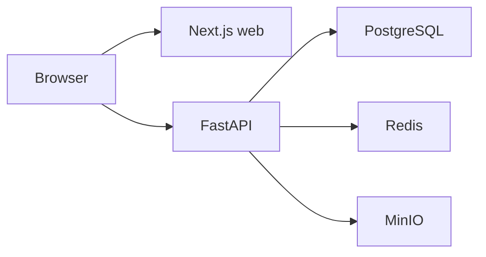

# Architecture

The first foundation slice runs five services with Docker Compose:

The API now stores knowledge bases in PostgreSQL through SQLAlchemy. Alembic migrations run before the local API starts, so the persistent PostgreSQL volume keeps created knowledge bases across stack restarts. Redis will support background jobs, and MinIO will provide an S3-compatible local object-store contract.

Nuxt, Django, cloud infrastructure, Kafka, DynamoDB, and Kubernetes are deferred until their roadmap phases.
