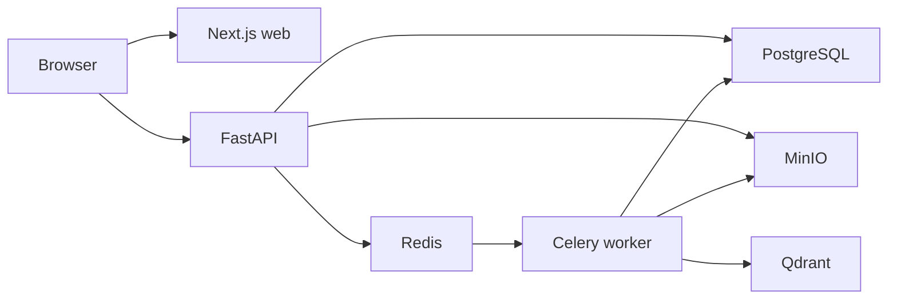

# Architecture

The local stack runs web, API, worker, PostgreSQL, Redis, MinIO, and Qdrant.

PostgreSQL stores durable metadata, processing records, and chunks. MinIO stores original files. Redis and Celery run background processing, and Qdrant stores chunk vectors. No pgvector is used.

Nuxt, Django, cloud infrastructure, Kafka, DynamoDB, and Kubernetes are deferred until their roadmap phases.
