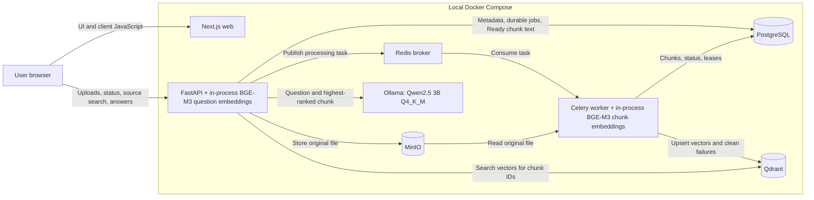

# Architecture

The local stack runs web, API, worker, PostgreSQL, Redis, MinIO, Qdrant, and an internal Ollama service.

The editable [system overview diagram](../license/asthing-system-overview.drawio) can be opened in diagrams.net.

The browser loads the Next.js UI and calls FastAPI directly using `NEXT_PUBLIC_API_URL`; Next.js does not proxy these API requests. The current app uses one local workspace.

PostgreSQL stores durable metadata, processing records, leases, and chunk text. MinIO stores original PDF, TXT, and DOCX files, with one file of up to 25 MiB per upload. After saving the original and committing metadata with a queued processing job, the API publishes a task through Redis. The Celery worker reads the original, extracts and persists chunks, embeds them, and writes their vectors to Qdrant before marking the document Ready. Processing uses renewable leases and one worker process. On processing failure, cleanup removes vectors and chunks before finalizing Failed; queued jobs, expired leases, and pending cleanup can be recovered through the `documents.recover` task. The browser polls for status while documents are Uploaded or Processing.

BAAI/bge-m3 runs locally on CPU inside both the API and worker, using the pinned revision in `app/embeddings.py`. It produces 1024-dimensional vectors. The worker has a persistent `embedding_model_cache` volume; the default API container does not mount that volume. Qdrant stores vectors and identifier/filtering payloads, while PostgreSQL remains the authority for source text and filenames. No pgvector is used.

Source search embeds the question in the API, searches Qdrant within the selected knowledge base and embedding revision, and hydrates up to five matching Ready chunks from PostgreSQL. Source search returns excerpts without generating an answer.

For one-shot answers, the API reuses retrieval, selects only the highest-ranked chunk (`MAX_ANSWER_CONTEXT_CHUNKS = 1` in `app/answers.py`), and sends the trimmed question and that source text to Ollama. Ollama serves `qwen2.5:3b-instruct-q4_K_M` and stores its model in a separate `ollama_model_cache` volume. The API verifies the pinned manifest digest before each generation, validates the generated reference keys, and returns an answer with response-scoped source references or an explicit `no_answer`. Prompts, answers, and conversation history are not persisted. Ollama is internal to Compose, permits one active generation, and is not required for API startup, uploads, processing, or source search.

Nuxt, Django, cloud infrastructure, Kafka, DynamoDB, and Kubernetes are deferred until their roadmap phases.
