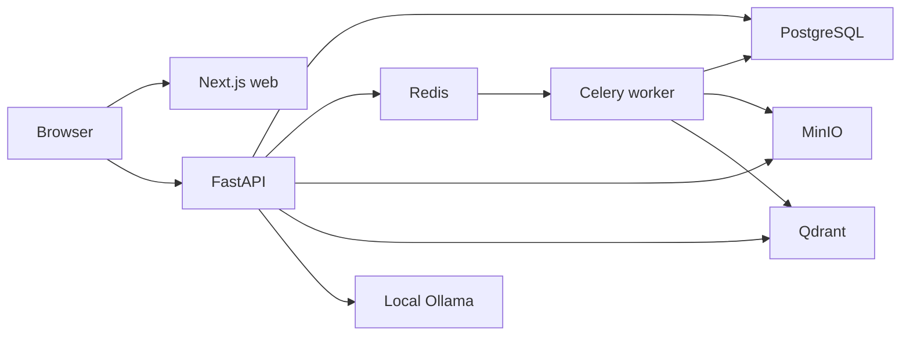

# Architecture

The local stack runs web, API, worker, PostgreSQL, Redis, MinIO, Qdrant, and an internal Ollama service.

PostgreSQL stores durable metadata, processing records, and chunks. MinIO stores original files. Redis and Celery run background processing, and Qdrant stores chunk vectors. No pgvector is used.

For one-shot answers, the API reuses retrieval, hydrates Ready chunks from PostgreSQL, and sends only the trimmed question and selected source text to Ollama. Ollama uses the pinned local Qwen2.5 3B model stored in a separate named cache volume. It is not required for API startup, uploads, processing, or source search.

Nuxt, Django, cloud infrastructure, Kafka, DynamoDB, and Kubernetes are deferred until their roadmap phases.
